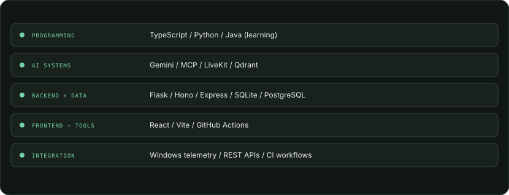

<!-- PROFILE:GENERATED:START -->
<picture><source media="(prefers-color-scheme: dark)" type="image/gif" srcset="assets/hero-motion.gif"><source media="(prefers-color-scheme: light)" type="image/gif" srcset="assets/hero-motion-light.gif"></picture>

<picture><source media="(prefers-color-scheme: dark)" type="image/gif" srcset="assets/typing.gif"><source media="(prefers-color-scheme: light)" type="image/gif" srcset="assets/typing-light.gif"></picture>

**Explore** · [About](#who-i-am) · [Hands-on engineering](#hands-on-engineering) · [Selected work](#selected-work) · [Education](#education--technical-activity) · [Telemetry](#public-telemetry) · [Contact](#contact--navigation) · [How this profile is built](SETUP.md)

<picture><source media="(prefers-color-scheme: dark)" type="image/gif" srcset="assets/signal.gif"><source media="(prefers-color-scheme: light)" type="image/gif" srcset="assets/signal-light.gif"></picture>

[GitHub profile](https://github.com/Sarthaksulkhlan) · [Browse my repositories](https://github.com/Sarthaksulkhlan?tab=repositories)

## Who I am

<table width="100%"><tbody><tr><td width="32%" valign="top" align="center">
<picture><source type="image/gif" srcset="assets/profile-portrait.gif"></picture>

COMPUTER SCIENCE / DATA SCIENCE
</td><td width="68%" valign="top">

### sarthak@build — profile

| Field | Details |
|:--|:--|
| study | B.Tech, Computer Science and Engineering (Data Science) |
| interests | Software engineering · data science · applied AI |
| project stack | TypeScript · Python · React · Flask · SQL |
| learning | Java problem solving · generative AI systems |
| focus | Practical systems whose behavior can be observed and improved |

I’m studying computer science and learning by building useful software. I’m interested in turning ideas into working systems, understanding their behavior through data, and making AI-enabled tools more dependable.

**Current focus:** Building practical systems, understanding their behavior through data, and learning how to make AI-enabled software useful and dependable.

**Projects:** [EPOCH](https://github.com/Sarthaksulkhlan/epoch-software.evolution) · [Asset Sentinel](https://github.com/Sarthaksulkhlan/Asset-Sentinel) · [MatrixCore](https://github.com/Sarthaksulkhlan/Nexis---Starforge)

</td></tr></tbody></table>

<picture><source media="(prefers-color-scheme: dark)" type="image/gif" srcset="assets/signal.gif"><source media="(prefers-color-scheme: light)" type="image/gif" srcset="assets/signal-light.gif"></picture>

## Hands-on engineering

Organized by project evidence and current study; not a proficiency ranking.

<picture>
  <source media="(prefers-color-scheme: dark)" srcset="assets/skills.svg">
  <source media="(prefers-color-scheme: light)" srcset="assets/skills-light.svg">
  
</picture>

### Programming & problem solving

TypeScript · Python · Java (learning)

TypeScript and Python appear across selected project repositories; Java is a current learning focus.

### AI & generative systems

Gemini · MCP · LiveKit · Qdrant

Documented in the MatrixCore and EPOCH project READMEs; explored through project work.

### Backend, APIs & data

Flask · Hono · Express · SQLite · PostgreSQL · Supabase

Used in the Asset Sentinel, EPOCH, and MatrixCore repositories.

### Frontend & developer tooling

React · Vite · TypeScript · GitHub Actions

Present in the selected project source and this profile's verified build workflow.

### Systems & integration

Windows agent telemetry · REST APIs · CI workflows · service integration

Capabilities represented by the Asset Sentinel agent/API/dashboard and documented project workflows.

Learning focus

Java problem solving and generative AI systems are current learning topics.

## Selected work

Three documented projects, each approaching a different systems problem. Descriptions and stacks are based on their public repository READMEs.

### [EPOCH](https://github.com/Sarthaksulkhlan/epoch-software.evolution)

**01 / SYSTEM EVOLUTION / HACKATHON PROTOTYPE**

A governed software-evolution workbench for a watched payments service: records approved changes, checks invariants, tracks drift and incidents, and measures alternative futures at a human approval gate. The repository includes a runnable demo and guarded public console.

`change` → `invariants` → `future comparison` → `human decision`

**Built with** `TypeScript` · `Hono` · `React 19` · `SQLite` · `MCP` · [Project demo](https://epoch-wj5b.onrender.com/) · [Repository](https://github.com/Sarthaksulkhlan/epoch-software.evolution)

### [Asset Sentinel](https://github.com/Sarthaksulkhlan/Asset-Sentinel)

> **02 / ENDPOINT TELEMETRY / FLEET VISIBILITY**
>
> Windows agents → authenticated API → PostgreSQL → fleet dashboard

A Windows monitoring system that sends heartbeat, hardware, session, and foreground-application signals through a Python agent and Flask API into a Supabase PostgreSQL store and React dashboard. Its README documents an end-to-end deployment and a demo using demonstration data.

**Built with** `Python` · `Flask` · `PostgreSQL` · `React` · `TypeScript`

[Project demo](https://assetsentinel.onrender.com) · [Repository](https://github.com/Sarthaksulkhlan/Asset-Sentinel)

### [MatrixCore](https://github.com/Sarthaksulkhlan/Nexis---Starforge)

**03 / VOICE SYSTEMS / HACKATHON DEMO**

An adaptive voice-agent demo with a browser client, an Express service, and a Python LiveKit agent. The documented voice path connects LiveKit, Gemini, Qdrant retrieval, and Rime speech; local use requires external service credentials.

| Voice client | Agent services |
|:--|:--|
| Browser UI → Express API | Python LiveKit → Gemini → Qdrant → Rime |

**Built with** `TypeScript` · `Express` · `Python` · `LiveKit` · `Gemini` · [Project demo](https://ai.studio/apps/f2d187b6-edd7-4e75-9a39-42f65428df0a) · [Repository](https://github.com/Sarthaksulkhlan/Nexis---Starforge)

<picture>
  <source media="(prefers-color-scheme: dark)" srcset="assets/project-landscape.svg">
  <source media="(prefers-color-scheme: light)" srcset="assets/project-landscape-light.svg">
  
</picture>

<picture><source media="(prefers-color-scheme: dark)" type="image/gif" srcset="assets/signal.gif"><source media="(prefers-color-scheme: light)" type="image/gif" srcset="assets/signal-light.gif"></picture>

## Education & technical activity

**B.Tech, Computer Science and Engineering (Data Science)**

Studying Computer Science and Engineering (Data Science); building practical software while developing foundations in data and AI engineering.

**Project activity:** EPOCH is documented as a team prototype built for the IBM Bob 2.0 hackathon. See [the repository](https://github.com/Sarthaksulkhlan/epoch-software.evolution).

## Public telemetry

Public repository metadata and a limited public event sample. No private activity or contribution totals are inferred.

**Last fully successful data refresh:** 2026-10-12 11:52:36 UTC.

**Repository snapshot:** 4 original public repositories · 2 stars across those repositories.

**Event sample:** 11 public PushEvents returned.

Expand recent public activity visualization

<picture><source media="(prefers-color-scheme: dark)" type="image/gif" srcset="assets/activity-motion.gif"><source media="(prefers-color-scheme: light)" type="image/gif" srcset="assets/activity-motion-light.gif"></picture>

<picture>
  <source media="(prefers-color-scheme: dark)" srcset="assets/activity.svg">
  <source media="(prefers-color-scheme: light)" srcset="assets/activity-light.svg">
  
</picture>

Activity groups only PushEvents returned by GitHub's public user-events endpoint (up to 100 recent public events). It is a sample, not a contribution history; an empty bucket does not prove there was no GitHub activity.

<picture>
  <source media="(prefers-color-scheme: dark)" srcset="assets/language-stats.svg">
  <source media="(prefers-color-scheme: light)" srcset="assets/language-stats-light.svg">
  
</picture>

**Language mix:** TypeScript 75.7% · Python 20.3% · CSS 1.5% · Other 2.5%.

Language shares use GitHub-reported source-byte totals across owned, non-fork public repositories; the profile repository is excluded.

How to read the telemetry

The activity plot groups PushEvents in GitHub’s latest public user-events response (up to 100 events) into 12 week buckets. It is a sample, not a full contribution history.

## Contact & navigation

[GitHub profile](https://github.com/Sarthaksulkhlan) · [All public repositories](https://github.com/Sarthaksulkhlan?tab=repositories) · [EPOCH](https://github.com/Sarthaksulkhlan/epoch-software.evolution) · [Asset Sentinel](https://github.com/Sarthaksulkhlan/Asset-Sentinel) · [MatrixCore](https://github.com/Sarthaksulkhlan/Nexis---Starforge)

[Back to introduction](#who-i-am) · [How this profile is built](SETUP.md)

Self-hosted GIFs add subtle motion in GitHub’s rendered README; static SVG or PNG fallbacks retain the information. Telemetry uses public GitHub data and a limited event sample.
<!-- PROFILE:GENERATED:END -->
