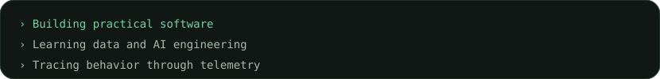
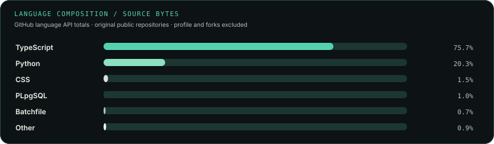

<!-- PROFILE:GENERATED:START -->
<picture>
  <source media="(prefers-color-scheme: dark)" srcset="assets/hero.svg">
  <source media="(prefers-color-scheme: light)" srcset="assets/hero-light.svg">
  
</picture>

<picture><source media="(prefers-color-scheme: dark)" type="image/gif" srcset="assets/typing.gif"><source media="(prefers-color-scheme: light)" type="image/gif" srcset="assets/typing-light.gif"></picture>

**Explore** · [About](#about) · [Hands-on Engineering](#hands-on-engineering) · [Selected Work](#selected-work) · [Experience](#experience) · [Education](#education) · [Telemetry](#telemetry) · [Contribution Art](#contribution-art) · [Contact](#contact) · [How This Profile Is Built](SETUP.md)

<picture>
  <source media="(prefers-color-scheme: dark)" srcset="assets/divider.svg">
  <source media="(prefers-color-scheme: light)" srcset="assets/divider-light.svg">
  
</picture>

## About

<table width="100%"><tbody><tr><td width="34%" align="center" valign="top"></td><td width="66%" valign="top">
<h3><code>sarthak@systems</code> / about</h3>
<table><tbody><tr><th align="left">Study</th><td>B.Tech, Computer Science and Engineering (Data Science)</td></tr><tr><th align="left">Interests</th><td>Software engineering · data science · applied AI</td></tr><tr><th align="left">Project work</th><td>Verified software, telemetry, and voice-system projects</td></tr><tr><th align="left">Learning</th><td>Java problem solving · Python · generative AI</td></tr><tr><th align="left">Focus</th><td>Building practical, reliable software systems</td></tr></tbody></table>

I’m a computer science student who learns by building. I enjoy taking an idea through implementation, observing how a system behaves, and using that evidence to improve it.

<strong>Selected repositories</strong> <a href="https://github.com/Sarthaksulkhlan/epoch-software.evolution">EPOCH</a> · <a href="https://github.com/Sarthaksulkhlan/Asset-Sentinel">Asset Sentinel</a> · <a href="https://github.com/Sarthaksulkhlan/Nexis---Starforge">MatrixCore</a>

</td></tr></tbody></table>

<picture>
  <source media="(prefers-color-scheme: dark)" srcset="assets/divider.svg">
  <source media="(prefers-color-scheme: light)" srcset="assets/divider-light.svg">
  
</picture>

## Hands-on Engineering

Icons use Skill Icons; each links to an official learning page. If the icon service is unavailable, the linked image’s alt label remains visible.

### Languages

### Frameworks & development

### AI & data

### Databases

### Cloud & tooling

Project libraries documented in MatrixCore include [MCP](https://modelcontextprotocol.io/docs), [LiveKit](https://docs.livekit.io/), and [Qdrant](https://qdrant.tech/documentation/). Java is shown as a learning focus.

<picture>
  <source media="(prefers-color-scheme: dark)" srcset="assets/divider.svg">
  <source media="(prefers-color-scheme: light)" srcset="assets/divider-light.svg">
  
</picture>

## Selected Work

Three verified projects, described from their repositories. Titles link to source; demos are shown only for the two deployed project sites.

### [EPOCH](https://github.com/Sarthaksulkhlan/epoch-software.evolution)

**01 / SYSTEM EVOLUTION / HACKATHON PROTOTYPE**

A governed software-evolution workbench for a watched payments service: records approved changes, checks invariants, tracks drift and incidents, and measures alternative futures at a human approval gate. The repository includes a runnable demo and guarded public console.

**Technologies:** `TypeScript` · `Hono` · `React 19` · `SQLite` · `MCP`

[Live demo](https://epoch-wj5b.onrender.com/) · [Repository](https://github.com/Sarthaksulkhlan/epoch-software.evolution)

### [Asset Sentinel](https://github.com/Sarthaksulkhlan/Asset-Sentinel)

**02 / ENDPOINT TELEMETRY / FLEET VISIBILITY**

A Windows monitoring system that sends heartbeat, hardware, session, and foreground-application signals through a Python agent and Flask API into a Supabase PostgreSQL store and React dashboard. Its README documents an end-to-end deployment and a demo using demonstration data.

**Technologies:** `Python` · `Flask` · `PostgreSQL` · `React` · `TypeScript`

[Live demo](https://assetsentinel.onrender.com) · [Repository](https://github.com/Sarthaksulkhlan/Asset-Sentinel)

### [MatrixCore](https://github.com/Sarthaksulkhlan/Nexis---Starforge)

**03 / VOICE SYSTEMS / HACKATHON DEMO**

An adaptive voice-agent demo with a browser client, an Express service, and a Python LiveKit agent. The documented voice path connects LiveKit, Gemini, Qdrant retrieval, and Rime speech; local use requires external service credentials.

**Technologies:** `TypeScript` · `Express` · `Python` · `LiveKit` · `Gemini`

[Repository](https://github.com/Sarthaksulkhlan/Nexis---Starforge)

<picture>
  <source media="(prefers-color-scheme: dark)" srcset="assets/divider.svg">
  <source media="(prefers-color-scheme: light)" srcset="assets/divider-light.svg">
  
</picture>

## Experience

**AI Intern** · Prajjo HR — Kenbox Technologies 
Noida, On-site · June 2026 – August 2026

## Education

**B.Tech, Computer Science and Engineering (Data Science)** · JSS Academy of Technical Education · AKTU · 2024–2028

**Coursework:** Data Structures · Database Systems · Operating Systems · Computer Networks · Software Engineering

<picture>
  <source media="(prefers-color-scheme: dark)" srcset="assets/divider.svg">
  <source media="(prefers-color-scheme: light)" srcset="assets/divider-light.svg">
  
</picture>

## Telemetry

Public account statistics and language totals are refreshed daily by GitHub Actions. The event chart is a limited sample from the public events API, not a complete contribution history.

**Last fully successful data refresh:** 2026-10-12 13:05:27 UTC.

<picture>
  <source media="(prefers-color-scheme: dark)" srcset="assets/activity.svg">
  <source media="(prefers-color-scheme: light)" srcset="assets/activity-light.svg">
  
</picture>

<picture>
  <source media="(prefers-color-scheme: dark)" srcset="assets/language-stats.svg">
  <source media="(prefers-color-scheme: light)" srcset="assets/language-stats-light.svg">
  
</picture>

Language mix by GitHub-reported bytes: TypeScript 75.7% · Python 20.3% · CSS 1.5% · Other 2.5%.

## Contribution Art

The public event feed does not provide a complete daily contribution calendar, so this profile shows only the weekly groups it can verify.

Open the sampled weekly activity trace

<picture>
  <source media="(prefers-color-scheme: dark)" srcset="assets/contribution-art.svg">
  <source media="(prefers-color-scheme: light)" srcset="assets/contribution-art-light.svg">
  
</picture>

Activity groups only PushEvents returned by GitHub's public user-events endpoint (up to 100 recent public events). The oldest chart bin includes events 11+ weeks old. This is a sample, not a contribution history; an empty bucket does not prove there was no GitHub activity.

How to read these metrics

Repository count and stars are from GitHub’s public repository API and exclude forks and this profile repository. Followers come from the public user endpoint. Language shares use repository language byte totals. PushEvents are grouped into twelve week buckets from the latest public user-events response, which is capped at 100 events.

## Contact

[GitHub profile](https://github.com/Sarthaksulkhlan) · [All public repositories](https://github.com/Sarthaksulkhlan?tab=repositories) · [How this profile is built](SETUP.md)

One small self-hosted typing GIF is the only looping animation. The portrait, hero, project cards, and telemetry are static SVG/PNG assets. GitHub does not animate SVG; see <a href="https://docs.github.com/en/repositories/working-with-files/using-files/working-with-non-code-files">GitHub image support</a>.
<!-- PROFILE:GENERATED:END -->
