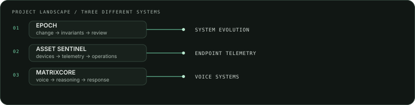

<!-- PROFILE:GENERATED:START -->
<picture>
  <source media="(prefers-color-scheme: dark)" srcset="assets/hero.svg">
  <source media="(prefers-color-scheme: light)" srcset="assets/hero-light.svg">
  
</picture>

**I build practical software at the intersection of computer science, data, and AI.**

**Explore** · [About](#who-i-am) · [Hands-on engineering](#hands-on-engineering) · [Selected work](#selected-work) · [Education & activity](#education--technical-activity) · [Telemetry](#public-telemetry) · [Contact](#contact--navigation)

[GitHub profile](https://github.com/Sarthaksulkhlan) · [Browse my repositories](https://github.com/Sarthaksulkhlan?tab=repositories) · [Jump to selected work](#selected-work)

## Who I am

I’m studying **Computer Science and Engineering (Data Science)** and learning by building. I’m interested in software engineering, data-informed systems, and AI engineering: turning an idea into something people can try, then making its behavior easier to inspect and improve.

Building practical systems, understanding their behavior through data, and learning how to make AI-enabled software useful and dependable.

**Currently learning:** `Java problem solving` · `generative AI systems` · `Python`.

<picture>
  <source media="(prefers-color-scheme: dark)" srcset="assets/divider.svg">
  <source media="(prefers-color-scheme: light)" srcset="assets/divider-light.svg">
  
</picture>

## Selected work

Three documented projects, each approaching a different systems problem. Project descriptions and stacks are drawn from their public repository READMEs.

### [EPOCH](https://github.com/Sarthaksulkhlan/epoch-software.evolution)

**01 / SYSTEM EVOLUTION / HACKATHON PROTOTYPE**

A governed software-evolution workbench for a watched payments service: records approved changes, checks invariants, tracks drift and incidents, and measures alternative futures at a human approval gate. The repository includes a runnable demo and guarded public console.

`change` → `invariants` → `future comparison` → `human decision`

**Built with** `TypeScript` · `Hono` · `React 19` · `SQLite` · `MCP` · [Project demo](https://epoch-wj5b.onrender.com/) · [Repository](https://github.com/Sarthaksulkhlan/epoch-software.evolution)

### [Asset Sentinel](https://github.com/Sarthaksulkhlan/Asset-Sentinel)

> **02 / ENDPOINT TELEMETRY / FLEET VISIBILITY**
>
> Windows agents → authenticated API → PostgreSQL → fleet dashboard

A Windows monitoring system that sends heartbeat, hardware, session, and foreground-application signals through a Python agent and Flask API into a Supabase PostgreSQL store and React dashboard. Its README documents an end-to-end deployment and a demo using demonstration data.

**Built with** `Python` · `Flask` · `PostgreSQL` · `React` · `TypeScript`

[Project demo](https://assetsentinel.onrender.com) · [Repository](https://github.com/Sarthaksulkhlan/Asset-Sentinel)

### [MatrixCore](https://github.com/Sarthaksulkhlan/Nexis---Starforge)

**03 / VOICE SYSTEMS / HACKATHON DEMO**

An adaptive voice-agent demo with a browser client, an Express service, and a Python LiveKit agent. The documented voice path connects LiveKit, Gemini, Qdrant retrieval, and Rime speech; local use requires external service credentials.

| Voice client | Agent services |
|:--|:--|
| Browser UI → Express API | Python LiveKit → Gemini → Qdrant → Rime |

**Built with** `TypeScript` · `Express` · `Python` · `LiveKit` · `Gemini` · [Project demo](https://ai.studio/apps/f2d187b6-edd7-4e75-9a39-42f65428df0a) · [Repository](https://github.com/Sarthaksulkhlan/Nexis---Starforge)

## Hands-on engineering

A project-evidence map, not a proficiency ranking. Technologies below are documented in the linked implementations; items marked learning are current study topics.

### Programming & problem solving

`TypeScript` · `Python` · `Java (learning)`

TypeScript and Python appear across selected project repositories; Java is a current learning focus.

### AI & generative systems

`Gemini` · `MCP` · `LiveKit` · `Qdrant`

Documented in the MatrixCore and EPOCH project READMEs; explored through project work.

### Backend, APIs & data

`Flask` · `Hono` · `Express` · `SQLite` · `PostgreSQL` · `Supabase`

Used in the Asset Sentinel, EPOCH, and MatrixCore repositories.

### Frontend & developer tooling

`React` · `Vite` · `TypeScript` · `GitHub Actions`

Present in the selected project source and this profile's verified build workflow.

### Systems & integration

`Windows agent telemetry` · `REST APIs` · `CI workflows` · `service integration`

Capabilities represented by the Asset Sentinel agent/API/dashboard and documented project workflows.

**Learning alongside project work:** `Java problem solving` · `generative AI systems`.

<picture>
  <source media="(prefers-color-scheme: dark)" srcset="assets/project-landscape.svg">
  <source media="(prefers-color-scheme: light)" srcset="assets/project-landscape-light.svg">
  
</picture>

<picture>
  <source media="(prefers-color-scheme: dark)" srcset="assets/divider.svg">
  <source media="(prefers-color-scheme: light)" srcset="assets/divider-light.svg">
  
</picture>

## Education & technical activity

**B.Tech, Computer Science and Engineering (Data Science)**

Studying Computer Science and Engineering (Data Science); building practical software while developing foundations in data and AI engineering.

**Project activity:** EPOCH is documented as a team prototype built for the IBM Bob 2.0 hackathon. See [the repository](https://github.com/Sarthaksulkhlan/epoch-software.evolution) for its scope and implementation details.

Internships, certificates, and other leadership or campus roles are not listed here because the current verified profile sources do not establish those details.

## Public telemetry

A compact view of public repository metadata and the limited public event sample. No private activity, contribution totals, or streaks are inferred.

**Last fully successful data refresh:** 2026-10-12 11:52:36 UTC.

**Repository snapshot:** 4 original public repositories · 2 stars across those repositories.

**Event sample:** 11 public PushEvents returned.

<picture>
  <source media="(prefers-color-scheme: dark)" srcset="assets/activity.svg">
  <source media="(prefers-color-scheme: light)" srcset="assets/activity-light.svg">
  
</picture>

Activity groups only PushEvents returned by GitHub's public user-events endpoint (up to 100 recent public events). It is a sample, not a contribution history; an empty bucket does not prove there was no GitHub activity.

<picture>
  <source media="(prefers-color-scheme: dark)" srcset="assets/language-stats.svg">
  <source media="(prefers-color-scheme: light)" srcset="assets/language-stats-light.svg">
  
</picture>

**Language mix:** TypeScript 75.7% · Python 20.3% · CSS 1.5% · Other 2.5%.

Language shares use GitHub’s reported source-byte totals across owned, non-fork public repositories. The profile README repository is excluded.

How to read the telemetry

Repository counts and stars are a cached snapshot from GitHub’s public repository API. Language shares are weighted by source bytes. The activity plot groups PushEvents in the latest public user-events response (up to 100 events) into 12 week buckets; GitHub’s feed is sampled and capped, so this view is not a complete contribution history. A missing bar does not prove no work happened.

## Contact & navigation

[GitHub profile](https://github.com/Sarthaksulkhlan) · [All public repositories](https://github.com/Sarthaksulkhlan?tab=repositories) · [EPOCH](https://github.com/Sarthaksulkhlan/epoch-software.evolution) · [Asset Sentinel](https://github.com/Sarthaksulkhlan/Asset-Sentinel) · [MatrixCore](https://github.com/Sarthaksulkhlan/Nexis---Starforge)

[Back to introduction](#who-i-am)

---
Portfolio telemetry is generated from public GitHub repository metadata and a limited recent event sample. Visual instruments are self-hosted. The signal trace is an animated GIF; SVG illustrations are static with no essential information conveyed by motion.
<!-- PROFILE:GENERATED:END -->
