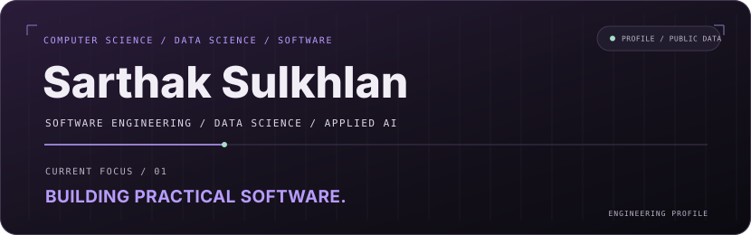
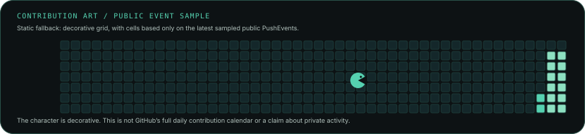

<!-- PROFILE:GENERATED:START -->

  <picture>
    <source media="(prefers-color-scheme: dark)" srcset="assets/hero.svg">
    <source media="(prefers-color-scheme: light)" srcset="assets/hero-light.svg">
    
  </picture>

  <strong>Explore</strong> · 
  <a href="#about">About</a> · 
  <a href="#telemetry">Telemetry</a> · 
  <a href="#contribution-art">Contribution Art</a> · 
  <a href="#selected-work">Selected Work</a> · 
  <a href="#hands-on-engineering">Hands-on Engineering</a> · 
  <a href="#experience">Experience</a> · 
  <a href="#education">Education</a> · 
  <a href="#contact">Contact</a>

<picture>
  <source media="(prefers-color-scheme: dark)" srcset="assets/divider.svg">
  <source media="(prefers-color-scheme: light)" srcset="assets/divider-light.svg">
  
</picture>

## Telemetry

  <picture>
    <source media="(prefers-color-scheme: dark)" srcset="assets/activity.svg">
    <source media="(prefers-color-scheme: light)" srcset="assets/activity-light.svg">
    
  </picture>

<picture>
  <source media="(prefers-color-scheme: dark)" srcset="assets/divider.svg">
  <source media="(prefers-color-scheme: light)" srcset="assets/divider-light.svg">
  
</picture>

## Contribution Art

  <picture>
    <source media="(prefers-color-scheme: dark)" srcset="assets/contribution-art.svg">
    <source media="(prefers-color-scheme: light)" srcset="assets/contribution-art-light.svg">
    
  </picture>

<strong>How to read these metrics</strong>

Public account statistics and language totals are refreshed from GitHub's public REST APIs. The event sample summarizes verified public PushEvents and commits across original public repositories (excluding forks and this profile repository).

<picture>
  <source media="(prefers-color-scheme: dark)" srcset="assets/divider.svg">
  <source media="(prefers-color-scheme: light)" srcset="assets/divider-light.svg">
  
</picture>

## About

<table width="100%">
  <tbody>
    <tr>
      <td width="34%" align="center" valign="top">
        
      </td>
      <td width="66%" valign="top">
        <h3><code>sarthak@systems</code> / about</h3>
        <table>
          <tbody>
            <tr><th align="left">Study</th><td>B.Tech, Computer Science and Engineering (Data Science)</td></tr>
            <tr><th align="left">Interests</th><td>Software engineering · data science · applied AI</td></tr>
            <tr><th align="left">Project work</th><td>Verified software, telemetry, and voice-system projects</td></tr>
            <tr><th align="left">Learning</th><td>Java problem solving · Python · generative AI systems</td></tr>
            <tr><th align="left">Focus</th><td>Building practical, reliable software systems</td></tr>
          </tbody>
        </table>
        
I’m a computer science student who learns by building. I enjoy taking an idea through implementation, observing how a system behaves, and using that empirical evidence to improve it.

        
<strong>Selected repositories</strong> 
          <a href="https://github.com/Sarthaksulkhlan/epoch-software.evolution">EPOCH</a> · 
          <a href="https://github.com/Sarthaksulkhlan/Asset-Sentinel">Asset Sentinel</a> · 
          <a href="https://github.com/Sarthaksulkhlan/Nexis---Starforge">MatrixCore</a> · 
          <a href="https://github.com/Sarthaksulkhlan/MediKiosk">MediKiosk</a>
        

      </td>
    </tr>
  </tbody>
</table>

<picture>
  <source media="(prefers-color-scheme: dark)" srcset="assets/divider.svg">
  <source media="(prefers-color-scheme: light)" srcset="assets/divider-light.svg">
  
</picture>

## Selected Work

Three verified projects described from their repositories, with runnable deployed sites where available:

### [EPOCH](https://github.com/Sarthaksulkhlan/epoch-software.evolution)
**01 / SYSTEM EVOLUTION / HACKATHON PROTOTYPE**

A governed software-evolution workbench for a watched payments service: records approved changes, checks invariants, tracks drift and incidents, and measures alternative futures at a human approval gate. The repository includes a runnable demo and guarded public console.

- **Domain pipeline:** `change → invariants → review`
- **Technologies:** `TypeScript` · `Hono` · `React 19` · `SQLite` · `MCP`
- **Links:** [Live Demo](https://epoch-wj5b.onrender.com/) · [Source Repository](https://github.com/Sarthaksulkhlan/epoch-software.evolution)

---

### [Asset Sentinel](https://github.com/Sarthaksulkhlan/Asset-Sentinel)
**02 / ENDPOINT TELEMETRY / FLEET VISIBILITY**

A Windows monitoring system that sends heartbeat, hardware, session, and foreground-application signals through a Python agent and Flask API into a Supabase PostgreSQL store and React dashboard. Its README documents an end-to-end deployment and a demo using demonstration data.

- **Domain pipeline:** `devices → telemetry → operations`
- **Technologies:** `Python` · `Flask` · `PostgreSQL` · `React` · `TypeScript`
- **Links:** [Live Demo](https://assetsentinel.onrender.com) · [Source Repository](https://github.com/Sarthaksulkhlan/Asset-Sentinel)

---

### [MatrixCore](https://github.com/Sarthaksulkhlan/Nexis---Starforge)
**03 / VOICE SYSTEMS / HACKATHON DEMO**

An adaptive voice-agent demo with a browser client, an Express service, and a Python LiveKit agent. The documented voice path connects LiveKit, Gemini, Qdrant retrieval, and Rime speech; local use requires external service credentials.

- **Domain pipeline:** `voice → reasoning → response`
- **Technologies:** `TypeScript` · `Express` · `Python` · `LiveKit` · `Gemini`
- **Links:** [Source Repository](https://github.com/Sarthaksulkhlan/Nexis---Starforge)

<picture>
  <source media="(prefers-color-scheme: dark)" srcset="assets/divider.svg">
  <source media="(prefers-color-scheme: light)" srcset="assets/divider-light.svg">
  
</picture>

## Hands-on Engineering

A compact map of technologies represented in verified projects and current study. Each mark links to its official documentation.

<table align="center">
  <tbody>
    <tr>
      <td align="center">
        <strong>LANGUAGES</strong> 
        
        
        
        
      </td>
    </tr>
  </tbody>
</table>

<table align="center">
  <tbody>
    <tr>
      <td align="center">
        <strong>FRAMEWORKS &amp; DEVELOPMENT</strong> 
        
        
        
        
      </td>
    </tr>
  </tbody>
</table>

<table align="center">
  <tbody>
    <tr>
      <td align="center">
        <strong>AI &amp; DATA SYSTEMS</strong> 
        
        
        
        
      </td>
    </tr>
  </tbody>
</table>

  <code>SOFTWARE SYSTEMS</code> · <code>DATA PIPELINES</code> · <code>APPLIED AI</code> · <code>API DESIGN</code> · <code>OBSERVABLE WORK</code>

<picture>
  <source media="(prefers-color-scheme: dark)" srcset="assets/divider.svg">
  <source media="(prefers-color-scheme: light)" srcset="assets/divider-light.svg">
  
</picture>

## Experience

<table>
  <tbody>
    <tr><th align="left">Field</th><th align="left">Details</th></tr>
    <tr><td><strong>Role</strong></td><td>AI Intern</td></tr>
    <tr><td><strong>Organization</strong></td><td>Prajjo HR — Canvas Technologies</td></tr>
    <tr><td><strong>Location</strong></td><td>Noida, India</td></tr>
    <tr><td><strong>Duration</strong></td><td>June 2026 – August 2026</td></tr>
  </tbody>
</table>

## Education

**B.Tech, Computer Science and Engineering (Data Science)** · JSS Academy of Technical Education · Dr. A.P.J. Abdul Kalam Technical University (AKTU) · 2024–2028

**Coursework:** Data Structures & Algorithms · Database Systems · Operating Systems · Computer Networks · Software Engineering

<picture>
  <source media="(prefers-color-scheme: dark)" srcset="assets/divider.svg">
  <source media="(prefers-color-scheme: light)" srcset="assets/divider-light.svg">
  
</picture>

## Contact

[GitHub Profile](https://github.com/Sarthaksulkhlan) · [All Public Repositories](https://github.com/Sarthaksulkhlan?tab=repositories) · [How This Profile Is Built](SETUP.md)
<!-- PROFILE:GENERATED:END -->
